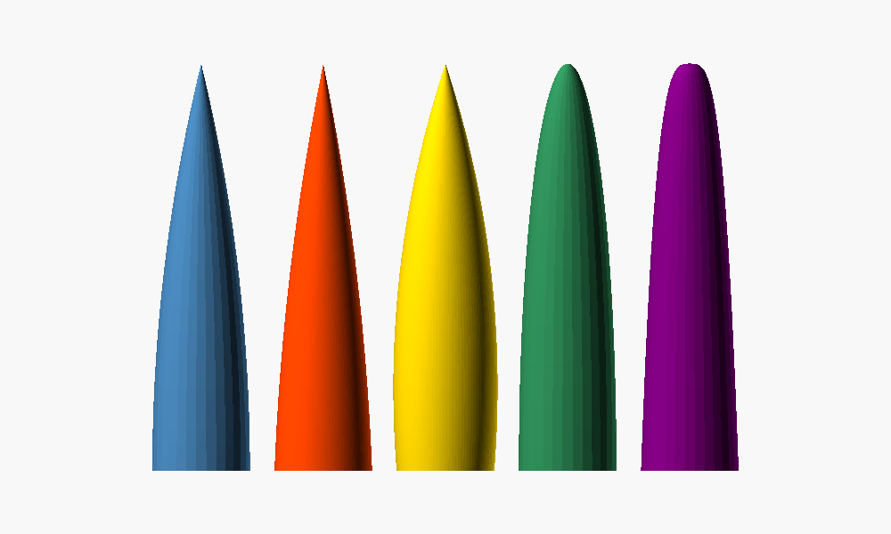
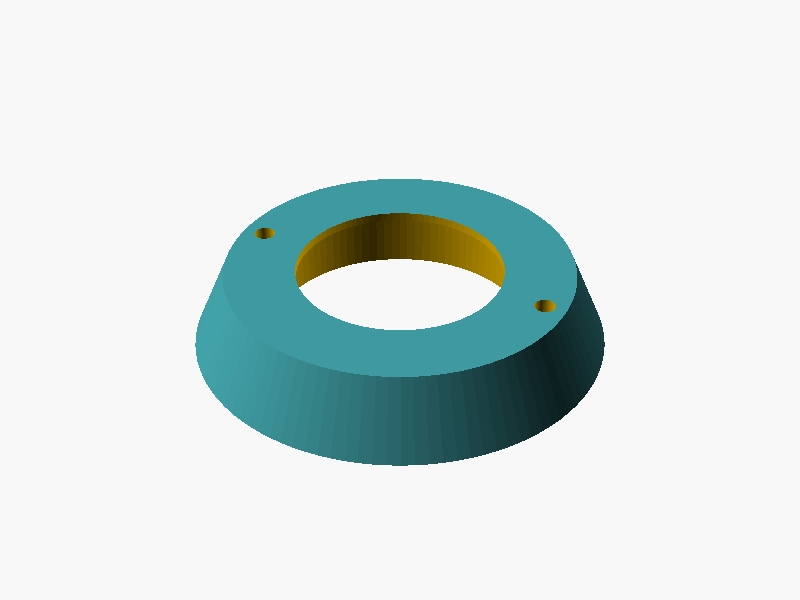
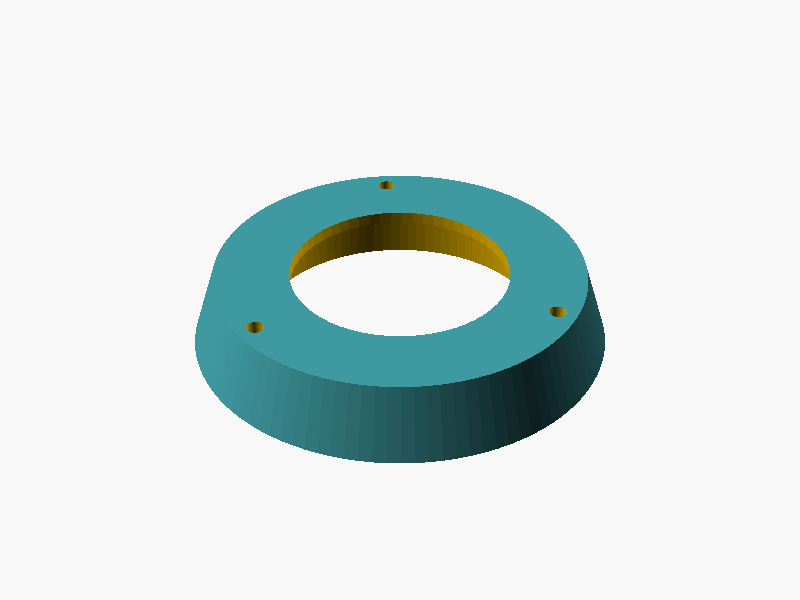
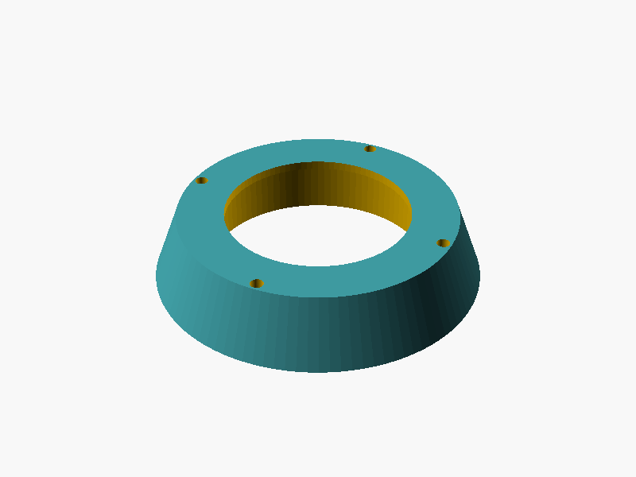
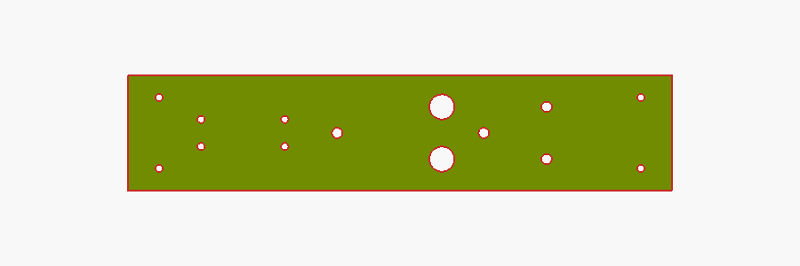
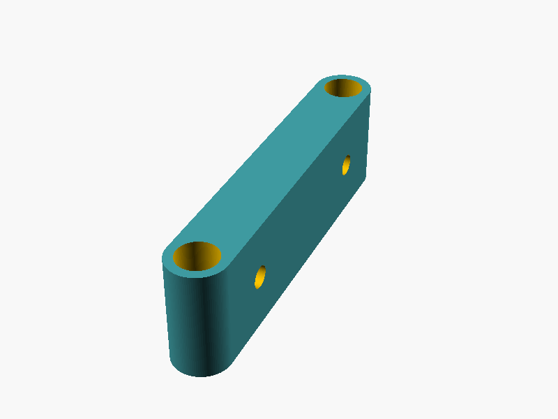

# Model-Rocket-3D-files

All my model rocket OpenSCAD 3D files: nose cones, motor retainers, rail buttons, avionics payload parts and screw switch mounts.

Every part is written in [OpenSCAD](https://openscad.org/), so you can change the dimensions to fit your own rocket. Most parts are meant to be **3D printed**, and some are 2D outlines for **laser cutting or CNC routing**. Ready-to-print STL files are included where available.

  

> All dimensions are in millimetres.

## Contents

| Folder | What's inside | Made by |
|---|---|---|
| [Advanced nose cones](Advanced%20nose%20cones) | 100 mm × 365 mm tangent ogive nose cone in 3 parts, with an exploded assembly view | 3D print + CNC |
| [noisecone_src](noisecone_src) | Parametric nose cone shapes: tangent, secant, elliptical, power series | 3D print |
| [Motor Retainers](Motor%20Retainers) | 29, 38, 54 and 76 mm motor retainers | 3D print / CNC washer |
| [2 parts rail buttons](2%20parts%20rail%20buttons) | Two-part rail buttons for 1010, 1515 and large rails | 3D print |
| [rail_button](rail_button) | One-piece and two-part 1010 rail buttons | 3D print |
| [payload_plate](payload_plate) | Avionics plate with altimeter footprints, and its spacers | 3D print / CNC |
| [screw switches](screw%20switches) | Mount for two screw switches | 3D print |

---

## Nose cones

### Advanced nose cones: 100 mm tangent ogive

A large nose cone for a 100 mm body tube, split into parts that fit on a normal printer bed:

- **Part 1, the ogive** (`nosecone_tangent100mm_365mmPart1.scad`): a hollow 365 mm tangent ogive shell with a bottom flange.
- **Part 2, the coupler** (`nosecone_100mm-emptyPart2.scad`): a hollow 97 mm coupler that slides into the body tube.
- **Part 3, the cap** (`nosecone_100mm-emptyPart3-withU-CNC.scad`): a 2D bulkhead to cut on a CNC or laser cutter, with the two holes for a U-bolt that holds the recovery harness.

The 3 parts are bolted together with 4 M3 screws and nuts. All shared dimensions live in `nosecone_tangent_main-100-365.scad`, so you change them in one place.

`nosecone_100mm_exploded_assembly.scad` shows all parts in place. You can set the explode distance, show a cutaway and animate the assembly.

The parts are built from 2D profiles and turned with a single `rotate_extrude()`, so they render in seconds.

 

### Parametric nose cone shapes

The `noisecone_src` folder holds simple solid nose cones. Set the length `L` and the base radius `R` at the top of each file:

| File | Shape | Extra parameter |
|---|---|---|
| `nosecone tangent.scad` | Tangent ogive | – |
| `nosecone secant.scad` | Secant ogive | `rho` (ogive radius) |
| `nosecone eliptical.scad` | Elliptical | – |
| `nosecone power series.scad` | Power series (cone, 3/4 power, parabola, etc.) | `n` |

Use `profileSegments` and `fnAround` to trade smoothness for render time.

---

## Motor retainers

Motor retainers that fit on the aft end of the motor mount tube and hold the motor in place with screws.

### 29 / 38 / 54 mm retainers

These are models of [Rowes retainers](http://www.rowesretainers.co.uk/), drawn from measurements of the real parts.

  
  
  

  
  
  

### 3D-printed retainers (38 / 54 / 76 mm)

Retainers redesigned for 3D printing, with a tapered outer body. Each file also has a 2D washer (`washer38()`, `washer54()`, and so on). Export it as SVG or DXF and cut it from plywood or G10. The SVG washers are already in each folder.

  
  
  

---

## Rail buttons

Rail buttons for aluminium launch rails. The two-part versions are screwed together through the body tube.

| Folder | Rail |
|---|---|
| [buttons 1010](2%20parts%20rail%20buttons/buttons%201010) | 1010 (20 × 20 mm) |
| [buttons 1515](2%20parts%20rail%20buttons/buttons%201515) | 1515 (30 × 30 mm) |
| [Large buttons](2%20parts%20rail%20buttons/Large%20buttons) | Large rails |
| [rail_button](rail_button) | 1010, one-piece or two-part |

  
  
  
  

---

## Avionics payload

### Payload plate

A 55 × 260 × 2 mm sled for the avionics bay. It has holes for two switches and for the altimeter. Footprints are included for my altimeters (AltiUno, AltiDuo, AltiDuoMini, AltiMulti); uncomment the one you need. You can 3D print the plate, or keep `projection(cut = true)` and export it as SVG or DXF to cut it on a CNC.

  

### Payload spacers

The spacers fix the plate onto the two threaded rods of the avionics bay. You need at least 2. Pick the file that matches your rod spacing and rod diameter:

| Rod spacing | Files |
|---|---|
| 35 mm | `payloadSpacer35mm.scad`, `payloadSpacer_35mm_3.5mm.scad` |
| 44 mm | `payloadSpacer44mm.scad`, `payloadSpacer_44mm_5.5mm.scad` |
| 50 mm | `payloadSpacer50mm.scad`, `payloadSpacer_50mm_5.5mm.scad` |
| 74 mm | `payloadSpacer74mm.scad`, `payloadSpacer_74mm_5.5mm.scad` |

 

### Screw switches

A mount for two screw switches. It slides onto the threaded rods of the avionics bay, so you can arm the altimeters from outside the rocket.

  
  

---

## How to use

1. Install [OpenSCAD](https://openscad.org/downloads.html).
2. Open the `.scad` file and change the parameters at the top of the file. Most files have a *"Do not modify anything after that"* line below the parameters.
3. Press **F5** to preview, then **F6** to render.
4. Export the part:
   - **File → Export → STL** for 3D printing.
   - **File → Export → DXF / SVG** for 2D parts you want to laser cut or CNC route.

**Tip:** print a short test piece first to check how it fits your tube. Printers vary, and a few tenths of a millimetre make a big difference on couplers and retainers.

## Author

Boris du Reau, [@bdureau](https://github.com/bdureau)
